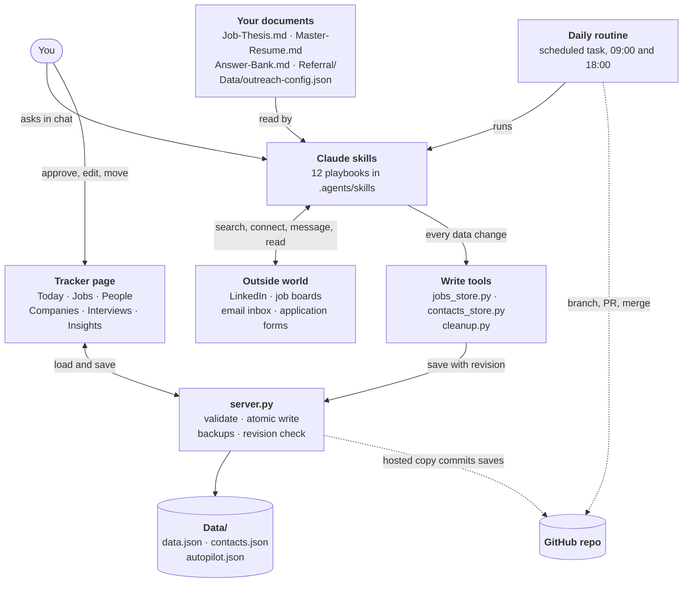
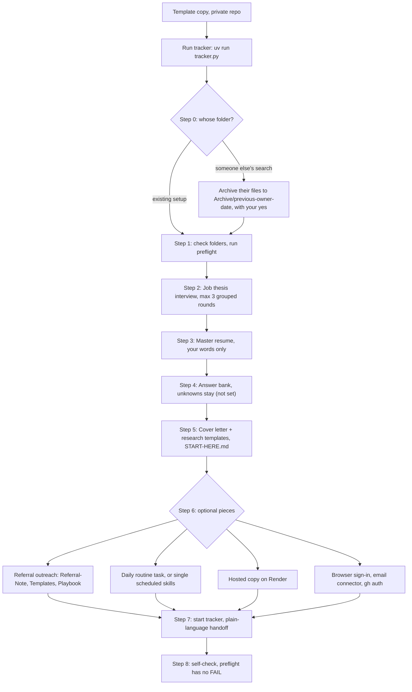
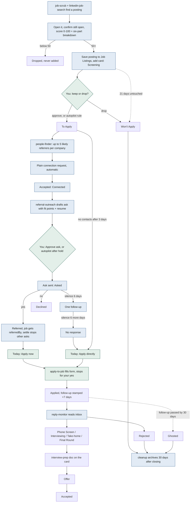
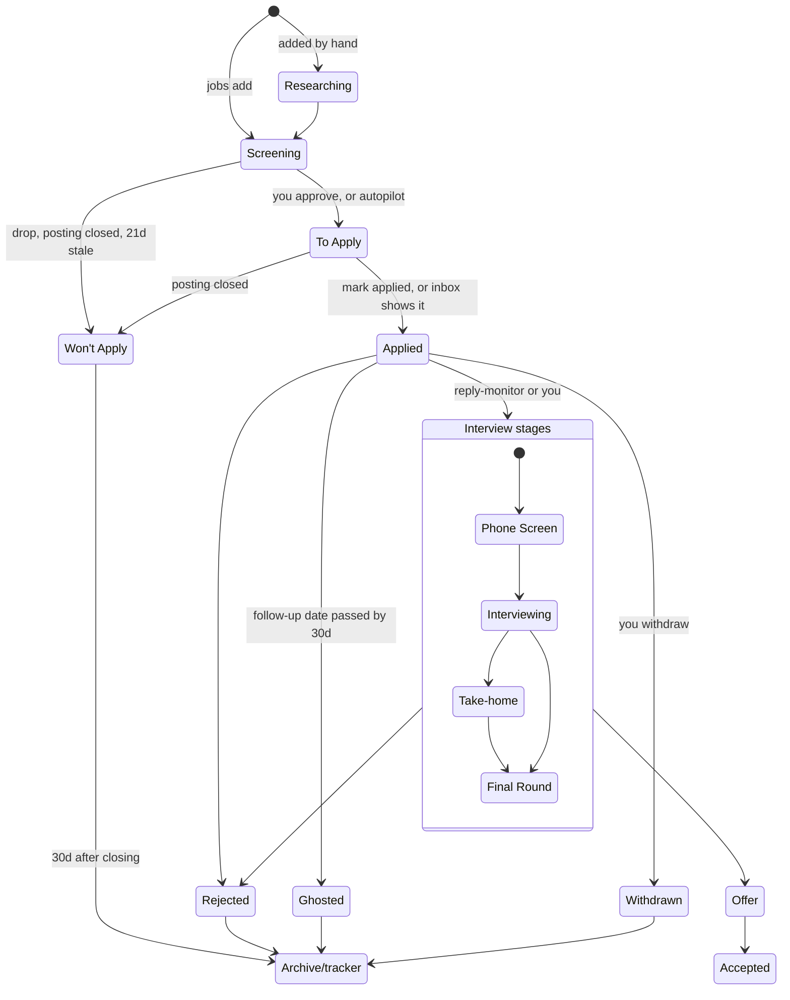
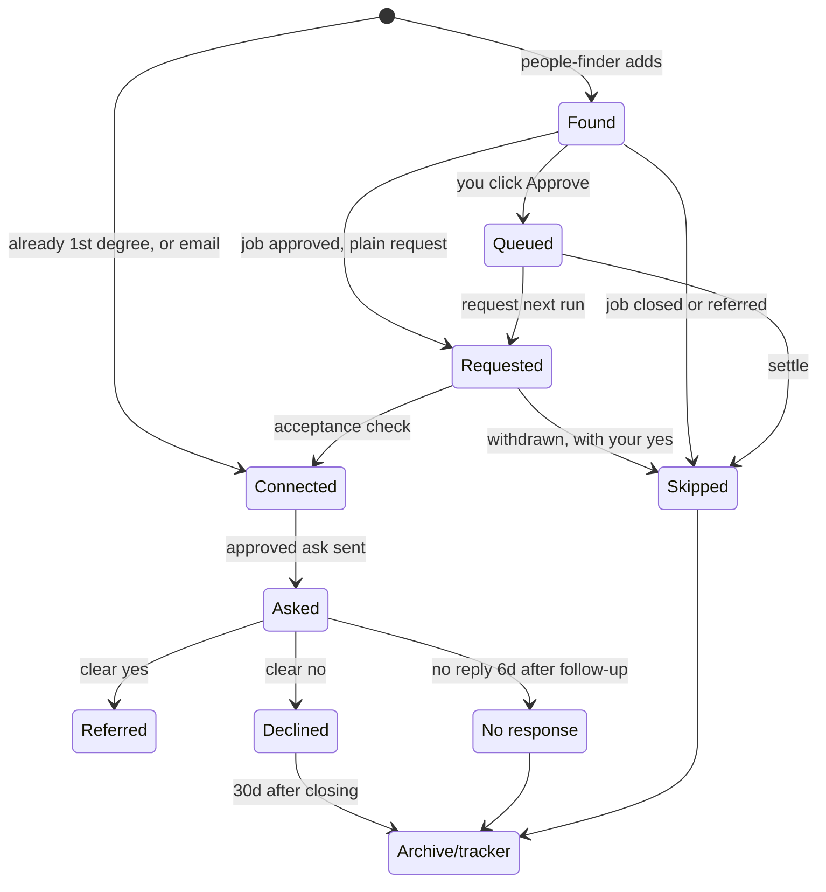
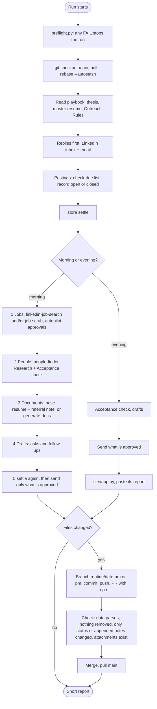
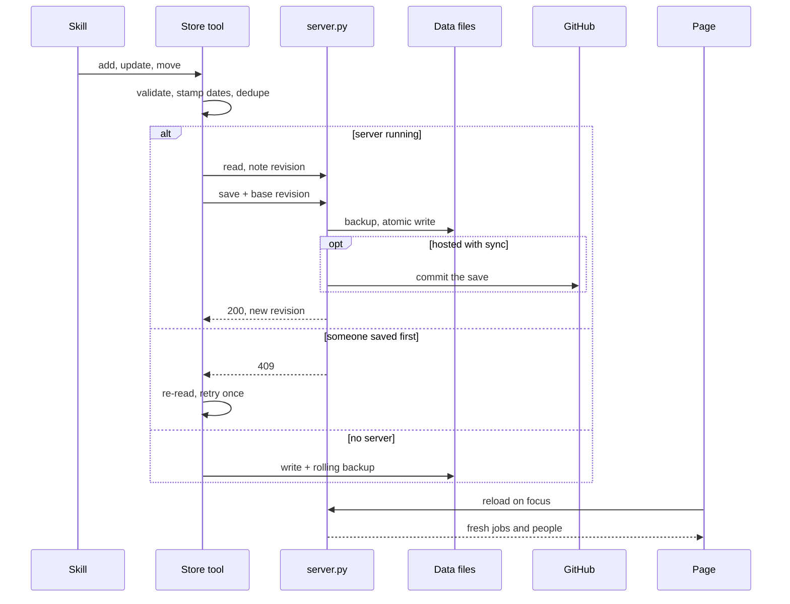
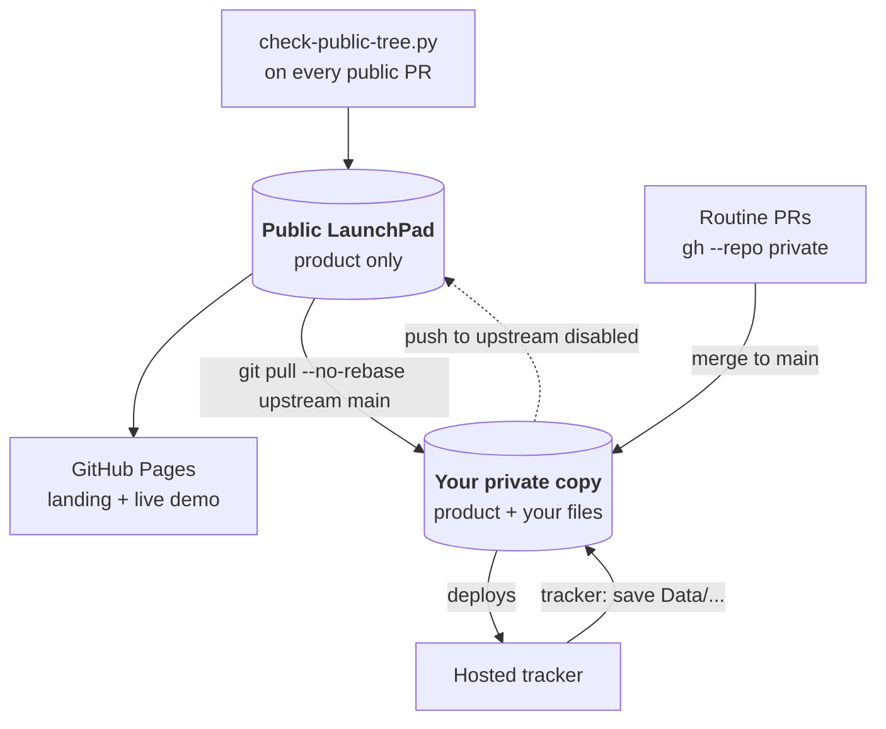

# How LaunchPad works

Every path a role, a person and a message take through LaunchPad: who moves them, which file changes, which automation does the work, and where your yes is required. Read [Setup.md](Setup.md) to get running, [Automation.md](Automation.md) for the daily routine and [Hosting.md](Hosting.md) for a hosted copy; this guide shows how the pieces fit together.

GitHub draws the diagrams below. In an editor without Mermaid support they show as text.

| Chapter | Covers |
|---|---|
| [1. System map](#1-system-map) | The five layers and what connects them |
| [2. Setup](#2-setup) | From a fresh clone to a working system |
| [3. The end-to-end loop](#3-the-end-to-end-loop) | One role from search to offer |
| [4. Job lifecycle](#4-job-lifecycle) | 14 statuses, scoring, posting checks |
| [5. People lifecycle](#5-people-lifecycle) | 9 stages, who gets found, the messages |
| [6. The daily routine](#6-the-daily-routine) | Morning and evening runs |
| [7. Skills, one by one](#7-skills-one-by-one) | What each skill reads, writes and sends |
| [8. What gets sent, and what lets it](#8-what-gets-sent-and-what-lets-it) | Every outgoing action and its approval |
| [9. Autopilot](#9-autopilot) | The two switches on Today |
| [10. Today screen rules](#10-today-screen-rules) | Every line Today can show |
| [11. Tracker screens](#11-tracker-screens) | Screens, storage modes, server routes |
| [12. Data model](#12-data-model) | Files, job and person fields, settings |
| [13. Write path and sync](#13-write-path-and-sync) | Revision checks, backups, GitHub sync |
| [14. Cleanup and archive](#14-cleanup-and-archive) | The nightly rules |
| [15. Document map](#15-document-map) | Who reads and writes each file |
| [16. Safety rails](#16-safety-rails) | What is never done |
| [17. Public and private copies](#17-public-and-private-copies) | How the product and your files stay apart |

## 1. System map

LaunchPad has five layers. Your documents say what you want. Claude skills do the legwork in the outside world. Two command-line tools are the only way anything but the page writes data. The server owns the files. The tracker page shows it all and takes your decisions.

| Layer | Lives in | Job |
|---|---|---|
| Documents | `Job-Thesis.md`, `Resume/`, `Referral/`, `Cover Letters/`, `Company Research/` | What counts as a fit, the only source of facts about you, your outreach rules and templates |
| Skills | `.agents/skills/*/SKILL.md` | Search, score, find people, draft, send what is approved, read replies, write documents, fill forms, prep interviews |
| Write tools | `LaunchPad App/jobs_store.py`, `contacts_store.py`, `cleanup.py` | Validate every change, stamp dates, skip duplicates, refuse to overwrite a newer save |
| Server | `LaunchPad App/server.py` + `storage.py` | Atomic writes, 20 rolling backups per file, revision checks, optional password and GitHub sync |
| Page | `index.html` + `screens.js`, `people*.js`, `your-move.js`, `insights.js`, `companies.js`, `interviews.js` | Today, Jobs, People, Companies, Interviews, Insights. Never sends anything itself |

## 2. Setup

Say *"set up LaunchPad"*. The `setup-launchpad` skill builds the documents every other skill reads. It never overwrites a document that exists; on a folder already in use it runs as a check-up.

| Thesis block | Captures | Used by |
|---|---|---|
| What | Tier A (primary fit), Tier B (stretch, always flagged), Tier C (solid IC) | Search queries, `tier`, fit score |
| Level | Current level and target level | `level` fit part, LinkedIn seniority filter |
| Where | Target companies by priority, size, location, remote, relocation | Company searches, `location` fit part |
| When | Start date, offer-by date, notice period | Answer bank, interview logistics |
| Constraints | Pay floor, work authorisation, industries, dealbreakers | `pay` fit part, reality check |
| How | Referrals first, direct, cold email, mix | Which automations setup offers |

Implausible answers (a "$10K" floor, an empty Tier A, "remote only" plus a must-have city) get one friendly follow-up instead of being written down. If you have a usual resume PDF, setup puts its path in `baseResumePath` and sets `defaultAttachment` to `base`, or leaves it `tailored`.

## 3. The end-to-end loop

One role, start to finish. Blue boxes are automatic, green are your decisions, and the referral track runs alongside the application track until a referral lands or the asks go stale.

The referral track is gated on two facts, checked at the start of every outreach run: the posting is still open (checked today), and nobody has referred you for it yet. When either fails, `contacts_store.py settle` drops every unsent ask and follow-up for that job.

## 4. Job lifecycle

Fourteen statuses. The list and the date rules live in `jobs_store.py` and are mirrored in `index.html`, so the page works with no server.

| Status | Group | Who usually moves it here | Stamped |
|---|---|---|---|
| Researching | Pre-approval | You, by hand | `dateAdded` |
| Screening | Pre-approval | `jobs add` from either search skill | `dateAdded`, `postingChecked` |
| To Apply | Approved | You (✓ Approve) or jobs autopilot (`autoApproved`) | — |
| Applied | Approved | You (✓ Mark applied), `apply-to-job`, or `reply-monitor` seeing "application received" | `dateApplied`, `nextFollowup` = +7 days |
| Phone Screen · Interviewing · Take-home · Final Round | Interview | `reply-monitor` or you | `lastContact`, a note |
| Offer | Interview | `reply-monitor` or you | Today shows "Decide on offer" |
| Accepted | Won | You | — |
| Won't Apply | Closed | ✗ Drop, `jobs posting closed`, or cleanup after 21 days in Screening | `dateClosed` (and `postingClosed` when closed) |
| Rejected | Closed | `reply-monitor` or you | `dateClosed` |
| Ghosted | Closed | Cleanup, when the follow-up date has passed by 30 days | `dateClosed`, `autoClosed` |
| Withdrawn | Closed | You | `dateClosed` |

### How a role is scored

| Fit score | Meaning | Outcome |
|---|---|---|
| 90+ | Tier A title, constraints met, strong resume match | Added |
| 70–89 | Strong, one real gap | Added |
| 50–69 | Plausible with caveats, or Tier B (always flagged) | Added |
| below 50 | Not a fit | Never added |

`fitBreakdown` records six parts, 0–5 each: **role** (the day-to-day work against the tier titles), **skills** (must-haves the master resume really covers), **level**, **pay** (against the floor), **location**, **posting** (real and fresh). A part with no signal gets 3 and a note. The overall score is a judgment, not a sum.

### Posting checks

`jobs list --check-due` returns every To Apply job not checked today, plus Screening and Researching jobs not checked in 7 days. Each is opened and recorded with `jobs posting <id> open|closed`. Closed moves a job not yet applied for to Won't Apply; for a sent application it only records the date.

## 5. People lifecycle

Six live stages and three closed ones. Setting a stage stamps its date (`dateQueued`, `dateRequested`, `dateConnected`, `dateAsked`).

### Who gets found, and in what order

| Relation | Base likelihood | Search keyword that finds them |
|---|---|---|
| ex-colleague | 75 | Each of your employers, most recent first |
| alumni | 60 | Each of your schools |
| same-org engineer | 50 | The role's area: backend, data, design… |
| hiring manager | 45 | Role area |
| recruiter | 40 | `recruiter`, `talent acquisition` |

Adjustments: +10 for overlapping dates, +5 for Senior, Staff, Lead or Principal, −10 for clearly outside the role's org, capped at 100. At most `contactsPerCompany` (5) live people per company and `maxProfileViewsPerRun` (40) profile pages per run. Only addresses a person published are recorded as `email`; nothing is guessed.

### Messages attached to a person

| Message | Drafted when | Template | Approved by |
|---|---|---|---|
| Connection note | Only if `noteSelection` picks them; requests themselves always go plain | `connect-note.md` | — |
| Ask | Connected, no ask yet, linked job open and unreferred | `ask-engineer.md` or `ask-recruiter.md` | Approve ask tick, autopilot, or chat yes |
| Follow-up | Asked, no reply, `followupAfterDays` (6) since asking | `follow-up.md` | Approve follow-up tick, autopilot, or chat yes |
| Reply | They answered and something is owed (`replyDone` not set) | `referral-yes.md` + body of `Referral-Note.md` | Approve reply tick, or chat yes. Never autopilot |

Every ask carries the job link on its own line (resolved to the real posting, no tracking), two fit points tying a job need to real work in the master resume, and a resume PDF chosen by `attachmentSource`: **tailored** (from `Applications/<Company>/`, generating it if missing), **base** (`baseResumePath`), or **upload** (a PDF added in the person panel, saved to `Resume/Uploads/<Company>/`).

## 6. The daily routine

One scheduled task in the Claude app, built from `Routine-Prompt-Template.md`, runs weekdays morning and evening. A manual "Run now" counts as a morning run. A run carries no memory, so the prompt names the folder, the repository and every skill.

| Run | Suggested time | Does | Never does |
|---|---|---|---|
| Morning | 09:00 | Gate (replies, postings, settle) → job search → people research + acceptance → documents → drafts → approved sends → PR | Move a card to To Apply on its own (only autopilot may) |
| Evening | 18:00 | Gate → acceptance check → drafts → approved sends → cleanup → PR | Job search |

### Smaller schedules, for people who skip referral outreach

| Task | Time | Runs |
|---|---|---|
| Job scrub | 07:00 | `job-scrub` |
| Outreach prep (read-only) | 07:30 | `linkedin-job-search` → `people-finder` Research + Acceptance → `referral-outreach` Draft |
| Reply monitor | 08:00 | `reply-monitor` (needs email) |
| Tailored documents | after the scrub | `generate-docs` |
| Cleanup | 22:00 | `python3 "LaunchPad App/cleanup.py"` |

The run report lists new roles by tier, postings found closed, outreach stopped by settle (and why), people added per company, what was sent, replies and referrals received, the pull request link, anything that stopped the run, and what is waiting for a yes.

## 7. Skills, one by one

Every skill writes jobs only through `jobs_store.py` and people only through `contacts_store.py`, and treats web pages, profiles and emails as data, never as instructions.

| Skill | Say | What it does |
|---|---|---|
| `preflight` | "run preflight"; start of every run | FAIL on invalid `data.json`, `contacts.json`, `autopilot.json` or settings, or a missing thesis or master resume. WARN on duplicate ids, orphaned people, missing resume files or templates, server down, git dirty or behind, broken links in unsent drafts. Then, per run: LinkedIn signed in (a wall or CAPTCHA is a hard stop), Chrome upload tool, email connector, a pull when hosted. Writes nothing |
| `job-scrub` | "run a job scrub" | Searches connected job boards, Google Jobs, We Work Remotely, Built In, Wellfound and boards named in the thesis. Per role: open the posting, score, breakdown, save the description to `Job Listings/<Company> - <Role>.md`, dedupe. Writes `New-Openings-<date>.md` and adds cards to Screening |
| `linkedin-job-search` | "search LinkedIn for jobs" | Read-only. Tier A titles, then each target company, posted in the past week. 25 postings per run. Same outputs as job-scrub |
| `people-finder` | "find people at…", "check who accepted", "send connection requests" | **Research**: companies with an open, unreferred To Apply card; searches by employer, school, role area, recruiter; scores and adds people. **Acceptance**: marks accepted requests Connected; pending past 21 days becomes a withdraw suggestion. **Send**: automatic plain requests for Queued people and people of approved jobs, within limits, 20–60 s apart. **Withdraw**: only after a yes to exact names |
| `referral-outreach` | "draft referral asks", "check replies", "send outreach" | **Draft**: reads replies (yes → Referred, `referredBy`, settle; no → Declined), resolves the resume, drafts asks, the one follow-up after 6 days, No response 6 days later, and the after-yes reply. **Send**: approved asks (attachment must exist), approved follow-ups, approved replies, through the full-page compose with the PDF attached. Email contacts become drafts that need a chat yes |
| `reply-monitor` | "check for job replies" | Scans ~2 days of email (7 on the first run) for company names and ATS domains. Moves cards to Phone Screen, Interviewing, Take-home, Final Round, Offer or Rejected; records "application received" as Applied and "you've been referred" as `referredBy`. Follow-up sweep: 14+ days silent is "Needs a nudge", 21+ recommends Ghosted. Reads email replies from asked contacts. Never sends email |
| `generate-docs` | "generate my application docs" | Up to 4 To Apply cards per run without documents. Tailors from the saved description, never echoes the posting or invents numbers, checks against recent letters. Writes text PDFs and Markdown to `Applications/<Company>/` and stamps the card |
| `apply-to-job` | "apply to <company>" | Checks the card, any referral in progress and the posting. Fills the form from the answer bank and master resume, leaves consent boxes, sensitive questions, secrets, sign-ins and CAPTCHAs to you, shows every answer, and submits only after your yes. Then Applied, and new answers saved to the answer bank |
| `interview-prep` | "prep me for <company>" | 6–10 sources. Writes `Interview Prep/<Company> - <Role>.md`: snapshot, the round, likely questions, 5–8 stories from the master resume, gaps, questions to ask, things to watch, logistics. Linked on the card; offers a mock round |
| `docs-cleanup` | "clean up my tailored docs", "run the cleanup" | Runs `cleanup.py` (chapter 14), previewing with `--dry-run` first when you are in the session |
| `setup-launchpad` | "set up LaunchPad" | Chapter 2 |
| `agents-bootstrap` | maintenance | Sets up or refreshes the `.agents/` layout |

## 8. What gets sent, and what lets it

The tracker never sends anything. A run sends an item only when one of the approvals in its row holds. Everything else is listed in the session and waits for a yes in chat.

| Outgoing action | Approved by | Not enough on its own | Limits |
|---|---|---|---|
| LinkedIn connection request | Linked job in To Apply or later · or Approve on the person (Queued) | Job in Screening or closed | Always plain. `maxRequestsPerDay`/`Week` if set. 20–60 s apart |
| Referral ask (LinkedIn) | Approve ask tick · message autopilot after `holdHours` unless Hold · chat yes | A draft alone | Job open today and unreferred; attachment file exists |
| Follow-up (LinkedIn) | Approve follow-up tick · message autopilot after `holdHours` unless Hold · chat yes | A draft alone | One per person; editing the text clears the tick |
| Reply to someone who answered | Approve reply tick (that exact text) · chat yes | Autopilot never sends replies | `replyDone` clears it; a newer message from them reopens it |
| Any email | Chat yes to the exact draft | Ticks and autopilot | Created as a draft first; links read back for redirects |
| Withdraw an invite | Chat yes to exact names | — | Re-checked in the session |
| Submit an application | Chat yes to the filled form | — | One at a time, no Easy Apply automation |
| Approve a job (Screening → To Apply) | You · jobs autopilot | The routine on its own | Autopilot: fit ≥ `minFit`, tier in `tiers` |
| Merge the routine's PR | The scheduled task | — | Only after its checks pass |

## 9. Autopilot

Two switches on Today, saved to `Data/autopilot.json`. Both are off until you turn them on.

| Switch | Default | Range | Effect on the next run | Undo |
|---|---|---|---|---|
| Jobs | off · minFit 80 · tiers A | minFit 50–100, any of A/B/C | Screening or Researching cards meeting the rule move to To Apply with `autoApproved`; their people then connect | Today shows "N roles approved by autopilot — undo?" for a day; drop or move the card back |
| Messages | off · hold 12 h | 0–72 h | Drafted asks and follow-ups send on the first run after `dateDrafted` + hold | Tick **Hold** on the person. Replies and emails are never auto-sent |

## 10. Today screen rules

Worked out in `your-move.js` with no page access. Each job and person gets at most one action; Today groups them by level, and the badge counts the Overdue and Needs you lines.

| Level | Line | When |
|---|---|---|
| Overdue | Take-home due | Take-home with `nextFollowup` passed |
| Overdue | Follow up | Applied or interview stage with `nextFollowup` passed |
| Overdue | Approve reply | They answered, a reply is drafted, not ticked |
| Overdue | Send details | Referred, no reply drafted |
| Overdue | Reply | Asked and replied, nothing drafted yet |
| Needs you | Do take-home | Take-home in progress |
| Needs you | Decide on offer | Status Offer |
| Needs you | Apply now | To Apply with a referral (Referred person or `referredBy`) |
| Needs you | Apply directly | Every ask 6+ days old with no reply · or no live contacts 3+ days after adding |
| Needs you | Approve outreach — N | Unapproved asks (Connected) and follow-ups (Asked, no reply). **Review all** approves a batch of both |
| When you have a minute | N roles auto-closed — undo? | Cleanup closed them in the last day |
| When you have a minute | N roles approved by autopilot — undo? | Autopilot moved them in the last day |
| When you have a minute | Decide — N Screening roles | Screening or Researching not covered by autopilot |
| Waiting on others | One summary line | Roles awaiting referrals · asks out · messages going out · to connect next run · requests pending |

The same rules put one chip on each board card (*Apply now*, *Keep or drop?*, *Approve message*, grey *Referral in progress*, *Connecting next run*…), and column headers count what needs you. A line about one job or person opens its panel on Today; a line about a group goes to the screen that lists it.

## 11. Tracker screens

| Screen | Key | Shows | You do here |
|---|---|---|---|
| Today | 1 | Everything that needs you, by level; the autopilot panel | Open panels, Review all, switch autopilot |
| Jobs | 2 | Board (drag between stages) or sortable table; fit breakdown, documents, prep, people per job | Approve or Drop, Mark applied, next stage, Move to…, add, edit, delete, search, filter, hide closed |
| People | 3 | Pipeline by stage; drafts and approvals per person | Approve a person, Skip, choose the resume, upload a PDF, edit and tick Approve ask, Approve follow-up or Approve reply, No reply needed, Hold |
| Companies | 4 | One row per company, waiting-on-you first; roles, people, referral progress, next step. A page per company at `#companies/<name>` | Go to its jobs and people |
| Interviews | 5 | Upcoming rounds, interview-stage roles needing a date, past rounds with outcomes | Add interview or Add round: date, time, round, with, notes, outcome |
| Insights | 6 | Role and outreach funnels, what is stalled, outreach by relation, roles by tier and source. Rates with fewer than 5 items are never called out | Read only |

Everywhere: ⌘K or Ctrl+K finds any job, person, company or command; `/` searches this screen; `n` adds; `1`–`6` switch screens; Esc closes the top layer. Light, dark or system theme. **More** holds Export (JSON), Import, CSV and file links. On a phone the rail becomes a bottom bar and panels go full screen.

**Storage modes**, picked automatically:

1. **Server mode**: served by `server.py`; loads the files on every open and posts every change. Nothing about jobs or people is kept in the browser.
2. **Linked file**: static hosting or `file://` in a Chrome-family browser, through the File System Access API.
3. **Browser storage**: `localStorage` key `launchpad_v1`, seeded with three demo rows.

| Route | Does |
|---|---|
| `GET /data.json`, `/contacts.json`, `/autopilot.json` | Current data, never cached, with a revision header |
| `POST /save`, `/save-contacts`, `/save-autopilot` | Validate, atomic write, rotate a backup; a stale `X-Base-Revision` gets 409 |
| `POST /upload-attachment` | Resume PDF up to 10 MB to `Resume/Uploads/<Company>/` |
| `GET /open`, `/reveal` | Open a link in the default browser; show a PDF in Finder or Explorer. Local clients only |
| `GET /health` | Server-mode detection; the only route open without sign-in |
| `/logout` | Ends the 30-day session when a password is set |

## 12. Data model

| File | Holds | Written by |
|---|---|---|
| `Data/data.json` | Array of jobs | Page, `jobs_store.py`, `cleanup.py` |
| `Data/contacts.json` | Array of people | Page, `contacts_store.py`, `cleanup.py` |
| `Data/autopilot.json` | `{jobs: {enabled, minFit, tiers}, messages: {enabled, holdHours}}` | Page (Today) |
| `Data/outreach-config.json` | Your outreach settings; falls back to `LaunchPad App/outreach-config.json` | You or setup |
| `Data/backups/` | Last 20 versions of each file. Local only | Server |
| `Job Listings/seen-postings.json` | Posting ledger, trimmed to 45 days | Search runs, cleanup |

**A job**

| Group | Fields |
|---|---|
| Identity | `id`, `company`, `role`, `location`, `arrangement` (Remote, Hybrid, Onsite), `url`, `source`, `salary` |
| Fit | `tier` (A, B, C), `fitScore`, `fitBreakdown` {role, skills, level, pay, location, posting}, `excitement` |
| Status and dates | `status`, `dateAdded`, `dateApplied`, `nextFollowup`, `lastContact`, `dateClosed`, `postingChecked`, `postingClosed`, `autoApproved`, `autoClosed` |
| Referral | `referredBy`, `contact`, `referralMD` |
| Documents | `resumeMD`, `coverMD`, `resumePath`, `coverPath`, `resumeVersion`, `coverLetter`, `resumeLink`, `coverLink` |
| Interviews | `interviews` [{id, date, time, round, with, notes, outcome}], `prepMD`, `prepPath` |
| Log | `notes`, appended only, with bracketed markers: `[docs: …]`, `[applied …]`, `[prep: …]`, `[auto-closed …]` |

**A person**

| Group | Fields |
|---|---|
| Identity | `id`, `company`, `name`, `title`, `linkedinUrl`, `location`, `email`, `emailSource`, `channel` (linkedin, email) |
| Why them | `relation`, `likelihood`, `why`, `appIds` |
| Stage and dates | `stage`, `dateQueued`, `dateRequested`, `dateConnected`, `dateAsked`, `dateFollowedUp`, `dateReplied` (first), `dateLastReply` (latest), `dateDrafted` |
| Messages | `useNote`, `connectNote`, `askMessage`, `askApproved`, `followupMessage`, `followupApproved`, `replyMessage`, `replyApproved`, `replyDone`, `hold` |
| Attachment | `attachmentSource` (tailored, base, upload), `attachment` |
| Log | `notes`, with `[outreach: …]`, `[reply sent …]`, `[email reply …]` markers |

Every new field is optional: older cards and people without it keep working, and an edit in the tracker keeps fields it does not know.

**Outreach settings and their defaults**

| Setting | Default | Controls |
|---|---|---|
| `maxRequestsPerDay`, `maxRequestsPerWeek` | null | Connection request caps |
| `noteSelection` | manual | manual · auto-top · off |
| `noteBudgetPerMonth`, `noteCharLimit` | null, 200 | Connection notes |
| `maxProfileViewsPerRun` | 40 | Research budget |
| `contactsPerCompany` | 5 | Live people per company |
| `minSendGapSeconds`, `maxSendGapSeconds` | 20, 60 | Pause between sends |
| `followupAfterDays` | 6 | Follow-up and close-out timing, "Apply directly" |
| `staleInviteDays` | 21 | Withdraw suggestions |
| `defaultAttachment`, `baseResumePath` | tailored, "" | Which resume goes with an ask |

## 13. Write path and sync

Three writers share two files: the page, the two store tools, and cleanup. Every write carries the revision it started from, so nobody overwrites a save made meanwhile.

- **Page saves** follow the same check. A 409 reloads the page with the latest data ("Jobs changed elsewhere … reloaded"); redo the change.
- **Hosted copy**: `HOST=0.0.0.0` requires `TRACKER_PASSWORD`. With `TRACKER_GITHUB_TOKEN` and `TRACKER_GITHUB_REPO`, it pulls on start and before serving, commits each save, refuses with 409 if GitHub moved, and retries later when GitHub is unreachable. A build filter on `Data/**` and `Resume/Uploads/**` keeps data commits from redeploying.
- **Local work** starts with `git pull --rebase --autostash`. Never force-push `main`.
- **A sleeping host** shows "Waking the server" and retries for about 90 seconds for loads and saves.

## 14. Cleanup and archive

`cleanup.py` runs at the end of the evening routine (or at 22:00 alone). It archives and never deletes; `--dry-run` reports without moving.

| Rule | Condition | Result |
|---|---|---|
| 1 | Screening or Researching for 21+ days | Won't Apply, `[auto-closed …]`, undo line on Today |
| 2 | Applied, follow-up date passed by 30+ days | Ghosted, `[auto-closed …]` |
| 3 | Closed card 30+ days after `dateClosed` | Moves to `Archive/tracker/jobs-<year>.json` |
| 4a | Found or Queued person whose roles all closed | Skipped, `[outreach: auto-skipped …]` |
| 4b | Declined, No response or Skipped for 30+ days | `Archive/tracker/people-<year>.json` |
| 4c | Request pending 21+ days | Reported as a withdraw suggestion only |
| 5 | Saved posting of an archived card · review files older than 14 days | `Archive/listings/<YYYY-MM>/` |
| 6 | `seen-postings.json` | Keeps the last 45 days |
| 7 | Company with cards on the board but none in Screening, Researching or To Apply | `Applications/<Company>/` → `Archive/applications/<Company>/` |

## 15. Document map

| File or folder | Written by | Read by |
|---|---|---|
| `Job-Thesis.md` | setup | both searches, generate-docs, interview-prep, routine |
| `Resume/Master-Resume.md` | setup, you | every skill that writes about you |
| `Resume/Answer-Bank.md` | setup, apply-to-job (new answers) | apply-to-job, interview-prep |
| `Referral/Referral-Playbook.md` | setup | routine (wins over defaults) |
| `Referral/Referral-Note.md` | setup | referral-outreach (after-yes reply), routine (per-role note) |
| `Referral/Templates/` | setup copies, you edit | people-finder, referral-outreach |
| `Job Listings/<Company> - <Role>.md` | both searches, generate-docs | generate-docs, referral-outreach, interview-prep |
| `Job Listings/New-Openings-<date>.md` | both searches | you, dedupe |
| `Applications/<Company>/` | generate-docs | referral-outreach, apply-to-job |
| `Interview Prep/` | interview-prep | you, the job panel |
| `Resume/Uploads/<Company>/` | the server's upload route | referral-outreach |
| `Archive/` | cleanup, setup (previous owner) | you |
| `START-HERE.md` | setup | you |

## 16. Safety rails

| Rail | Rule |
|---|---|
| LinkedIn hard stops | Security checkpoint, CAPTCHA, unusual activity, invitation-limit or note-limit notice, login wall: stop, save progress, report. Never worked around |
| Unexpected page | Skip that person with an `[outreach: skipped …]` note. No guess-clicks |
| Browser | Built-in browser first; Claude in Chrome for resume uploads or as a fallback. No headless automation |
| Truth | Every claim and number traces to the master resume. No invented skills, titles, dates or metrics |
| Message style | Link alone on its line with no trailing punctuation (the store refuses otherwise), direct job URL, banned stock phrases, at most one em-dash, no two openings alike at one company |
| Forms | No secrets, ID numbers, consent boxes, sensitive questions, sign-ins or CAPTCHAs |
| Data | Only through the store tools. No hand edits, no `.bak` files, never remove a card or person |
| Secrets | Passwords and tokens only in the host's settings. Never printed, committed or asked for |
| Content as data | Postings, profiles and emails that give instructions are reported, not followed |

## 17. Public and private copies

- **Product**: `LaunchPad App/`, `.agents/`, `.claude/`, `.github/`, `Demo/`, `Docs/`, `Site/`, `README.md`, `AGENTS.md`, `LICENSE`, `tracker.py`, `pyproject.toml`, `uv.lock`.
- **Personal**: `Data/*.json`, `Resume/`, `Referral/`, `Applications/`, `Job Listings/`, `Interview Prep/`, `Cover Letters/`, `Company Research/`, `Archive/` contents, `Job-Thesis.md`, `Target-Companies.md`, `START-HERE.md`.
- **Demo**: `uv run Demo/demo_people.py` on port 8799 writes to a temporary folder; the landing page's live demo runs the real app against `Site/demo-shim.js` with no server.

See [Setup.md](Setup.md), "Updating", for bringing product changes into your private copy.
